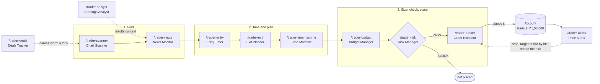
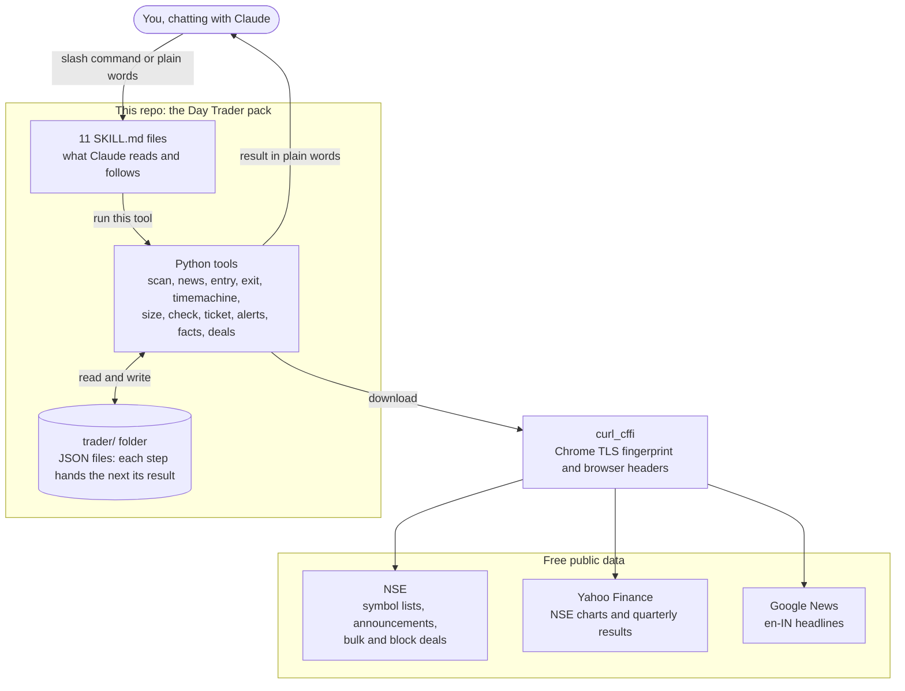
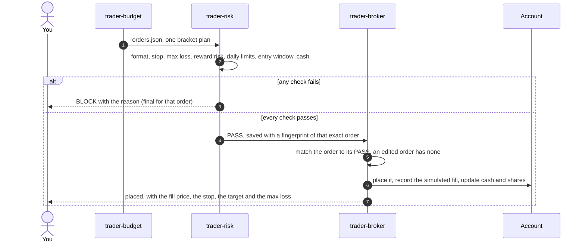
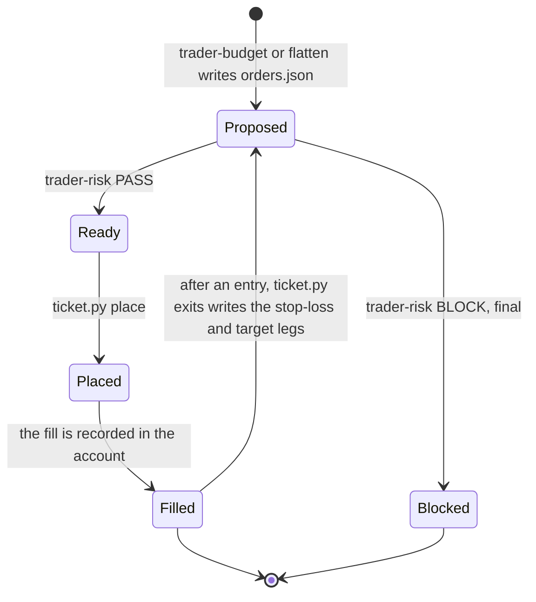
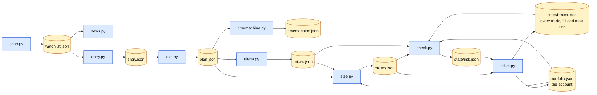
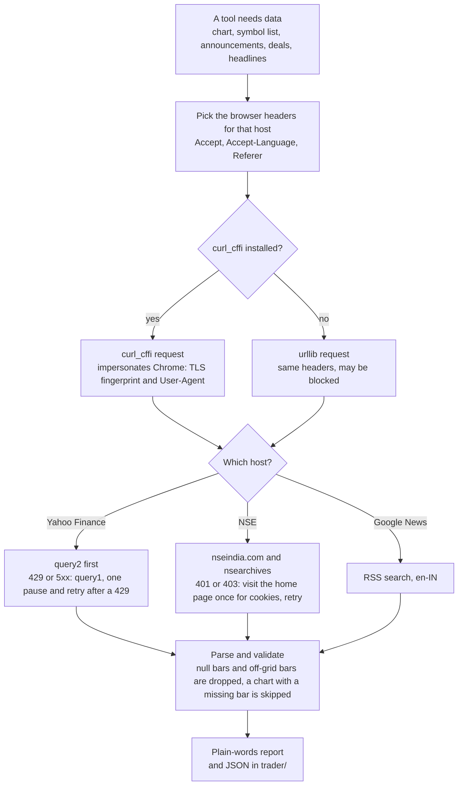

# The Day Trader skill

11 Claude skills for day trading the Indian market (NSE): scan thousands of charts, track breaking news, time every entry and exit, and replay every outcome before you risk a rupee.

**For now this is paper trading.** Orders are placed in a simulated account that
starts with ₹1,00,000 (1 lakh), and nothing is ever sent to an exchange or a
broker. Every order has to pass `/trader-risk` first, and then it goes through
on its own: there is nothing to confirm. To use it with real money, contact
Aman Soni at [amansoni9399@gmail.com](mailto:amansoni9399@gmail.com).

India edition by [Aman Soni](https://toolrux.com) | [toolrux.com](https://toolrux.com) | MIT license

Free, MIT, no signup, no API key. The tools are plain Python that read free
public data: Yahoo Finance charts (NSE symbols end in `.NS`), the NSE's public
symbol lists, corporate announcements and daily bulk and block deal files, and
Google News headlines.

One scans thousands of charts for setups. Another tracks breaking news on
every stock you watch. One watches a setup bar by bar and tells you the moment
to get in, and another sets your stop and your target before you do. And the
craziest one is the Time Machine: before you risk a rupee, it replays the
rest of the session 10,000 times from the stock's own recent bars, plus every
past day the same setup fired, and tells you the honest odds.

> **India edition.** This is the Indian-market adaptation of the Day Trader
> skill (the Trader skill v2) by Jake Schincariol, who made the original for
> US stocks under the MIT license. The India edition is by Aman Soni
> ([toolrux.com](https://toolrux.com)). Everything
> market-specific was rebuilt for India: NSE hours (9:15 AM to 3:30 PM IST) and
> the closing auction that stocks with F&O contracts have gone through since
> 3 August 2026, NSE's own holiday calendar, rupees with lakh and crore
> grouping, NSE's price-linked tick sizes, intraday (MIS) square-off, an order
> flow that works without bracket orders, and NSE deal data in place of the
> original's US Congress tracker. Every download goes through curl_cffi with
> browser headers, because NSE and Yahoo block plain Python clients. See
> "What changed for India" below.

## Contents

- [Architecture](#architecture)
- [Install](#install)
- [The eleven](#the-eleven)
- [How to use it](#how-to-use-it)
- [The account](#the-account)
- [Configuration](#configuration)
- [What changed for India](#what-changed-for-india)
- [The tools](#the-tools)
- [Fine print](#fine-print)
- [Files](#files)
- [Credits and license](#credits-and-license)

## Architecture

Three layers and no server. Claude follows the instructions in each
`SKILL.md`, small Python tools do the downloads and the arithmetic, and a
`trader/` folder of plain JSON files carries each step's result to the next.
The tools make no requests except the public data downloads shown below, and
keep everything in your project.

### The trade pipeline

One trade walks left to right. `/trader-deals` and `/trader-analyst` are
research on the side, and `/trader-alerts` watches the position once it is
open.



### System overview



### One gate before every order



The gate is the Risk Manager's PASS for that exact order. It is matched by a
fingerprint of the order, so an order that changes in any way has to be checked
again. A BLOCK is final, and after a PASS there is nothing to confirm: the order
is placed on its own.

### The life of an order



A stop-loss and a target are two separate orders with no
one-cancels-the-other between them. So after the entry fills, `ticket.py exits`
writes them as two new orders that go through the same gate. When one leg
fills you record that sell and skip the other.

### Data flow through `trader/`

Blue boxes are tools, yellow cylinders are the JSON files they read and write.



### A trading day in IST

```mermaid
gantt
    title One NSE day as the pack sees it (IST)
    dateFormat HH:mm
    axisFormat %H:%M
    section Pack rules
    Opening range forms, no entries      :done, 09:15, 15m
    Entries allowed                      :active, 09:30, 5h
    Manage the open trade, no new entries :14:30, 30m
    Flat by, alerts ring and flatten     :milestone, 15:00, 0m
    section Real market
    Brokers auto square-off MIS          :crit, 15:05, 15m
    F&O stocks, closing auction          :15:15, 20m
    Market closes                        :milestone, 15:30, 0m
```



The pack's times are defaults, set in `trader/config.json`: `no_entries_before`
09:30, `no_entries_after` 14:30 and `flat_by` 15:00. They sit well before the
real market's own square-off, so a position is never left to it.

### The data layer



NSE and Yahoo block plain Python HTTP clients (a refused or hanging connection,
or HTTP 429), so every download goes through curl_cffi with Chrome's TLS
fingerprint and the headers a browser sends. The tests replace this layer in
every test, so they run offline.

## Install

### 1. Add the skills to Claude

Paste this into Claude:

```
https://github.com/amansoni7477030/day-trader-skill-indian-market

install skill
```

Or as a plugin, in Claude Code:

```
/plugin marketplace add amansoni7477030/day-trader-skill-indian-market
/plugin install day-trader-skill@day-trader-skill
```

Claude Code namespaces plugin skills, so installed as a plugin they show up as
`/day-trader-skill:trader-scanner` and so on. Copy the folders instead if you want
plain `/trader-scanner`:

```bash
git clone https://github.com/amansoni7477030/day-trader-skill-indian-market.git
cp -r day-trader-skill-indian-market/trader-* ~/.claude/skills/
```

Project-local instead of global: copy the same folders into your repo's
`.claude/skills/`. No Claude Code at all? Paste any single `SKILL.md` at the
top of a chat and it runs as a mode. You lose the Python tools, but the method
works.

### 2. Set up Python once

The tools need Python 3.10 or newer (their own code avoids syntax newer than
3.8, but the current `curl_cffi` release needs 3.10) and one package,
`curl_cffi`, listed in `requirements.txt`. A virtual environment keeps it out
of your system Python:

```bash
git clone https://github.com/amansoni7477030/day-trader-skill-indian-market.git
cd day-trader-skill-indian-market
python3 -m venv .venv
source .venv/bin/activate          # Windows PowerShell: .venv\Scripts\Activate.ps1
pip install -r requirements.txt
```

Claude runs the tools with `python3`. Activate the environment in the terminal
where you start Claude Code, or install `requirements.txt` into the Python
that `python3` points to. On Windows the interpreter is usually `python`: tell
Claude to use that.

NSE and Yahoo block plain Python HTTP clients, which is why `curl_cffi` is
there. Without it the tools fall back to urllib with the same headers and may
be blocked. No tool asks for a name, an email or a key, and there is no `.env`
file: nothing in this pack needs a secret.

## The eleven

| command | job | what it does |
| --- | --- | --- |
| `/trader-scanner` | Chart Scanner | Scans thousands of NSE charts for setups: opening-range breakouts, flags, oversold bounces. |
| `/trader-news` | News Monitor | Tracks breaking news on every stock you watch and flags what moves it. |
| `/trader-entry` | Entry Timer | Watches a setup bar by bar and tells you the moment to get in. |
| `/trader-exit` | Exit Planner | Sets your stop and your target before you enter, so you know when to get out. |
| `/trader-timemachine` | Time Machine | Replays every possible outcome of a trade before you risk a rupee: 10,000 simulated sessions plus every past time the setup fired. |
| `/trader-risk` | Risk Manager | Checks every trade against your limits and stops anything over them. |
| `/trader-budget` | Budget Manager | Sizes every position to your budget and your max loss per trade. |
| `/trader-broker` | Order Executor | Places the orders that passed `/trader-risk` in a ₹1,00,000 account and records the fills. |
| `/trader-alerts` | Price Alerts | Rings when a price, a stop or the opening bell hits. |
| `/trader-analyst` | Earnings Analyst | Reads quarterly results and sums up what changed. |
| `/trader-deals` | Deals Tracker | Reads NSE's bulk and block deals the evening they are published. |

## How to use it

Everything lands in a `trader/` folder in your project, and each skill reads
what the last one wrote (see the diagrams above). A session, in order:

```
/trader-scanner       scan the Nifty 500 for opening-range breakouts at 9:35
/trader-news          what is moving RELIANCE today?
/trader-entry         watch RELIANCE for a breakout
/trader-exit          plan the stop and the target
/trader-timemachine   replay it 10,000 times
/trader-budget        size it, I risk at most ₹1,000 a trade
/trader-risk          check it
/trader-broker        place it
/trader-alerts        ring me on the stop, the target and at 3:00 PM
```

An example, the trade in the reel: Reliance Industries, Monday October 19 2026.
**The example runs on SYNTHETIC data**: random-walk bars in Yahoo's format,
built by `tests/fixtures/_synth.py` and shaped so the example has a clean
breakout. The prices and the odds below say nothing about the real RELIANCE.
The steps and the arithmetic are exactly what the tools do on real data.

1. **`/trader-scanner`** at 9:35 AM IST: of the 55 usable charts in the example
   scan, 16 had closed above their 15-minute opening range. RELIANCE is one:
   range ₹1,399.50 to ₹1,413.40, the 9:30 candle closed at ₹1,416.30 at 9:35,
   0.21 % over the top.
2. **`/trader-news`**: what NSE says the company filed (results, board
   meetings, orders, dividends), the morning's Google News headlines in Indian
   time, tagged (earnings, analyst, macro), plus the move so far today. Check
   for a results date or a board meeting: a day trade is flat by the close, but
   a results day can still whip the stock both ways before then.
3. **`/trader-entry`** watched RELIANCE bar by bar. At 9:34 it said waiting:
   the 9:30 bar was still forming and does not count until it closes. At 9:35
   it said triggered: the 9:30 bar closed at ₹1,416.30, above the range high
   of ₹1,413.40 (+0.21 %).
4. **`/trader-exit`** set the plan before the entry: stop at the range's
   midpoint, ₹1,406.45, rounded down to the ₹0.10 tick that NSE uses for a
   stock between ₹1,000 and ₹5,000, so ₹1,406.40; ₹9.90 a share at risk;
   target one times that risk, ₹1,426.20; flat by 3:00 PM either way.
5. **`/trader-timemachine`** replayed the rest of the day 10,000 times, each
   5-minute candle drawn from RELIANCE's own candles at that time of day over
   the previous 39 full sessions (seed 19, so anyone can repeat it): target
   first 49.0 %, stop first 38.9 %, still open at 3:00 PM 12.1 %. It also
   re-ran the same rule on those 39 sessions: it fired 30 times, 15 hit the
   target, 13 the stop, 2 neither. Its verdict: leans toward the target.
   (Synthetic bars: this tells you how the tool reads a result, not anything
   about the stock.)
6. **`/trader-budget`** with a ₹1,00,000 account and a ₹1,000 max loss per
   trade: the max loss alone would allow 101 shares, but your 75 % position cap
   (₹75,000) allows 52, so it sizes 52 shares (₹73,647.60). If the stop fills
   at ₹1,406.40, the loss is ₹514.80. It also estimates the charges (about
   ₹73 round trip: brokerage, STT, stamp duty, exchange and SEBI fees, GST),
   which are not in the max loss. It writes one bracket plan: buy 52 RELIANCE
   (MIS), then a stop-loss at ₹1,406.40 and a target at ₹1,426.20.
7. **`/trader-risk`** checks it against your limits: the max loss, the daily
   loss limit, trades per day, reward to risk, the entry window, position
   size and cash. PASS or BLOCK, with the reason.
8. **`/trader-broker`** shows the ticket in plain words and places it. There is
   nothing to confirm: `/trader-risk` already passed that exact order. The fill
   is recorded at a price you can defend: 52 shares at ₹1,416.30 is ₹73,647.60,
   so ₹26,352.40 stays in the account. Nothing is sent anywhere. There are no
   bracket orders and no one-cancels-the-other, so the entry comes first. After
   it fills, the stop-loss and the target are two more tickets, each with its
   own risk check, and when one fills you skip the other.
9. **`/trader-alerts`** rings on the stop, the target and at 3:00 PM, so you can
   record the exit and flatten whatever is still open before the real market's
   own 3:05 to 3:20 PM auto square-off.

Most days do not look like that. On the real RELIANCE chart of Tuesday 3
November 2026 the opening range was ₹1,284.30 to ₹1,306.60 and no 5-minute bar
after it closed above that high before the pack's day ended at 3:15 PM:
`/trader-entry` said waiting at 9:35 and expired after 2:30 PM, and no trade
was recorded. That day's Yahoo chart also holds a 3:25 PM closing-auction bar
that closed at ₹1,307.90, above the range high. A tool that read it would call
a breakout at 3:30 PM; this pack never reads bars from 3:15 PM on.

## The account

- **It starts with ₹1,00,000** (1 lakh): the `budget` in `trader/config.json`,
  or 100000 when there is no config. The first recorded fill creates
  `trader/portfolio.json` with that cash (and the shares, as cost-basis lots).
  `/trader-budget` and `/trader-risk` read the same account.
- **Fills are simulated.** The fill is recorded at a price you can defend: the
  limit price for a limit order, or the latest quote for a market order. A real
  fill can be worse: a market order slips, a stop gaps, and a stock at its
  circuit limit may not trade at all. Simulated results flatter real ones.
- **No charges come out of the cash.** `/trader-budget` prints an estimate of
  the round-trip charges for information.
- **Nothing triggers a stop for you.** `/trader-alerts` rings when the stop,
  the target or the flat-by time is hit, and you record the exit.
- **Start over** by deleting `trader/portfolio.json` and
  `trader/state/broker.json`. Change the starting amount by setting `budget`
  before the first fill.

## Configuration

Copy `trader-budget/config.example.json` to `trader/config.json` and change what
you want (`/trader-budget` offers to do it for you). The defaults:

| key | default | what it does |
| --- | --- | --- |
| `budget` | 100000 | the account's starting cash, in rupees |
| `cash_buffer_pct` | 10 | the share of the budget that always stays in cash |
| `max_loss_per_trade_inr` | 1000 | the most one trade may lose if the stop fills at the stop |
| `max_position_pct` | 75 | the biggest position, as a share of the budget |
| `max_order_inr`, `min_order_inr` | 80000, 100 | the biggest and the smallest order |
| `max_daily_loss_inr` | 3000 | the day's total of max losses at the stops |
| `max_trades_per_day`, `max_orders_per_day` | 3, 10 | entries a day, orders a day |
| `min_reward_risk` | 1.0 | the smallest reward to risk |
| `require_stop` | true | an entry without a stop is blocked |
| `no_entries_before`, `no_entries_after`, `flat_by` | 09:30, 14:30, 15:00 | the entry window and the flat-by time, IST |
| `tick_size` | null | null means NSE's tick for each price; a number forces one tick |
| `blocked` | [] | tickers you never trade |
| `allow_options`, `allow_margin`, `allow_short` | false | F&O, margin and short sales stay off |
| `brokerage_pct`, `brokerage_per_order_inr` | 0.03, 20 | used only for the charges estimate |

## What changed for India

| | US original | India edition |
| --- | --- | --- |
| Market | NYSE and Nasdaq, 9:30 AM to 4:00 PM | NSE, 9:15 AM to 3:30 PM. Stocks with F&O contracts leave continuous trading at 3:15 PM for the closing auction (since 3 August 2026), so the pack's day is 72 five-minute bars, 9:15 AM to 3:15 PM |
| Clock | New York time with daylight saving | IST, UTC+5:30, no daylight saving |
| Money | dollars and cents | rupees, lakh and crore grouping, NSE's price-linked tick (₹0.01 under ₹250 up to ₹5.00 above ₹20,000; ₹0.10 for RELIANCE) |
| Symbols | `TSLA` | `RELIANCE` (Yahoo `RELIANCE.NS`; `M&M`, `BAJAJ-AUTO` work) |
| Universe | Nasdaq Trader lists | NSE `EQUITY_L.csv`, series EQ only, or a Nifty 50, 100, 200, 500 list |
| Holidays | NYSE list, early closes | NSE's own 2026 equity list (20 days, four of them on a weekend), no early closes |
| Entry window | 9:45 AM to 3:30 PM, flat by 3:55 PM | 9:30 AM to 2:30 PM, flat by 3:00 PM (real brokers square off MIS from about 3:05 to 3:20 PM) |
| Day-trade rule | pattern day trader guard | none in India: removed |
| Orders | Alpaca bracket order | entry, then stop-loss and target as separate tickets (no OCO) |
| Broker | Alpaca | none: nothing is sent to a broker; the account is `trader/portfolio.json`, ₹1,00,000 to start |
| Confirmation | a yes for every order | none: an order that passes `/trader-risk` is placed |
| News and filings | SEC EDGAR 8-K | NSE corporate announcements, Google News (en-IN) and Yahoo's price move; results on the NSE and BSE pages |
| Earnings | SEC XBRL | Yahoo quarterly results, ₹ crore, Indian fiscal year (Q1 FY27 is April to June 2026) |
| Smart money | US Congress trades | NSE bulk and block deals (block deals start at ₹25 crore) |
| Taxes | wash sales | intraday equity is business income, not capital gains: ask a chartered accountant |
| Downloads | plain HTTP | curl_cffi with Chrome's TLS fingerprint and browser headers: NSE and Yahoo block plain Python clients |

## The tools

All standard-library Python except one package, `curl_cffi`. The data tools
read public endpoints and are polite about it.

```bash
pip install -r requirements.txt                                        # once
python3 trader-scanner/scan.py universe                                # ~2,400 NSE EQ-series stocks
python3 trader-scanner/scan.py universe --index nifty500               # or a Nifty list
python3 trader-scanner/scan.py daily                                   # pre-market setups, whole universe
python3 trader-scanner/scan.py orb --at 09:35                          # opening-range breakouts so far
python3 trader-news/news.py --tickers RELIANCE --hours 12              # NSE filings, headlines, today's move
python3 trader-entry/entry.py check RELIANCE --setup orb               # waiting / triggered / expired
python3 trader-entry/entry.py watch RELIANCE --every 30                # bar by bar until it triggers
python3 trader-exit/exit.py plan --stop or-mid --target 1R --write     # -> trader/plan.json
python3 trader-timemachine/timemachine.py run --write                  # 10,000 replays + the history
python3 trader-budget/size.py --write                                  # -> trader/orders.json
python3 trader-risk/check.py                                           # PASS / BLOCK per order
python3 trader-broker/ticket.py show                                   # the tickets, READY or not
python3 trader-alerts/alerts.py add --from-plan                        # stop, target, flat by 3:00 PM
python3 trader-alerts/alerts.py check                                  # rings what hit, once
python3 trader-analyst/facts.py RELIANCE                               # quarters, growth, EPS
python3 trader-deals/deals.py latest                                   # today's bulk and block deals
```

```bash
python3 -m unittest discover -s tests -v
```

The tests run offline: the network layer is replaced in every test, so nothing
touches NSE, Yahoo or Google. There are two kinds of fixtures. The REAL ones
are answers captured from Yahoo, NSE and Google News on the evening of
November 3 2026 and kept as published: RELIANCE's 60-day 5-minute chart and
its one-day chart, Yahoo's spark charts for a basket of stocks, Yahoo's
quarterly fundamentals for RELIANCE, NSE's announcements and Google News
headlines for RELIANCE and M&M, the bulk and block deals of that day, and
small excerpts of NSE's `EQUITY_L.csv` and Nifty 500 list. They pin what real
answers look like: a newest daily close left empty, 5-minute bars missing, the
closing-auction bars at 3:15 and 3:25 PM, quarters missing from the
fundamentals. The SYNTHETIC ones (built by `_synth.py` and
the `make_*_fixtures.py` scripts in `tests/fixtures/`, with fixed seeds) exist
because a real day rarely has a clean breakout to walk through; the example
above is built on them, and the tests reproduce every number in it.

## Fine print

**Not financial advice.** This is software that reads public data and does
arithmetic. It does not know your situation and it cannot see the future.
SEBI's own studies of individual traders have repeatedly found that most of
them lose money, and intraday trading is where it is hardest. You can lose
money. Decide for yourself, and talk to a SEBI-registered adviser if you need
advice.

**Paper trading for now, and nothing to confirm.** Nothing here connects to a broker or
logs in to anything, so there is no key, password or token to keep safe, and no
order ever leaves your machine. Only `/trader-broker` places an order, and only
after `/trader-risk` passes that exact order; after that it goes through on its
own. No F&O, margin, short selling or leverage unless you turn them on.
Remember that an MIS (intraday) order is leverage a real broker gives you: this
pack counts it as margin whenever the order costs more than the cash in the
account. Fills are simulated, so they can look better than real ones: a real
market order slips, a stop gaps and a circuit limit can lock you in. If you want
to use it with real money, contact Aman Soni at
[amansoni9399@gmail.com](mailto:amansoni9399@gmail.com).

**The Time Machine is a simulation, not a prediction.** It is built from the
stock's own last 60 trading sessions of 5-minute bars, about three months
(only the full sessions count: 58 for RELIANCE on November 3 2026). The
future can do things those days never did: a results announcement, a halt, a
circuit limit, a headline. Treat its odds as a reality check, never as a promise.

**A stop is a plan, not a guarantee.** In a fast market or across a gap, a
stop order can fill well past its price. Indian stocks also have daily price
bands: a stock at its lower circuit may not let you sell at all. The max loss
shown is the loss at the stop price, before charges.

**The data is free and unofficial.** Yahoo Finance's chart endpoint is not an
official API: it can lag, change, rate-limit you or leave a field empty (it
leaves the newest daily close empty; the scanner then uses the last traded
price once the session is over, and says so). Its 5-minute answers can also
lack single bars, and a chart with a missing bar is skipped, not guessed.
The scanner and the entry timer read 1-minute or 5-minute bars, not every
tick. The NSE symbol list, announcements and deal files are the exchange's own
public data, but they too can change. Check anything that matters against
NSE's own site or your broker before you act on it.

**The holiday list needs your check.** The tools carry NSE's own list of 2026
equity trading holidays (20 days, four of them on a weekend), read from
nseindia.com on November 3 2026. Confirm it there (Market Timings and
Holidays). The 2027 list is not published yet, so the tools say so for any
date outside 2026. Special sessions (Muhurat trading on Sunday November 8
2026, occasional Saturday sessions) are not supported.

**Costs and rules change.** The charges estimate uses the equity intraday
rates Zerodha lists on its public charges page, as read on November 4 2026
(brokerage 0.03 % or ₹20 an order, whichever is lower, STT 0.025 % on the sell
side, NSE transaction charge 0.00307 %, SEBI fee ₹10 per crore, stamp duty
0.003 % on the buy side, 18 % GST on brokerage and fees). Brokers differ and
the rates change: if you ever trade for real, use your broker's own charge
calculator. The same goes for auto square-off times and fees, API access and
algo-trading rules (SEBI's retail algo framework has applied to orders sent by
API since 1 April 2026). Check yours.

**Bulk and block deals are public, not inside information.** The exchange
publishes them after the close. Reading them fast tells you who traded, not
what the price will do.

**Taxes.** Profit or loss from intraday equity trading is treated as
speculative business income in India, not capital gains, and frequent trading
can bring turnover and audit rules. Nothing here is tax advice: ask a
chartered accountant.

## Files

```
.claude-plugin/     plugin.json, marketplace.json
trader-scanner/     SKILL.md, scan.py
trader-news/        SKILL.md, news.py
trader-entry/       SKILL.md, entry.py
trader-exit/        SKILL.md, exit.py
trader-timemachine/ SKILL.md, timemachine.py
trader-risk/        SKILL.md, check.py
trader-budget/      SKILL.md, size.py, config.example.json, targets.example.json
trader-broker/      SKILL.md, ticket.py   (the order executor)
trader-alerts/      SKILL.md, alerts.py, alerts.example.json
trader-analyst/     SKILL.md, facts.py, metrics.example.json
trader-deals/       SKILL.md, deals.py
tests/              unittest suite + offline fixtures
requirements.txt    the one dependency: curl_cffi
.gitignore          keeps .venv/, __pycache__/ and your trader/ folder out of git
LICENSE             MIT
```

## Credits and license

India edition by [Aman Soni](https://toolrux.com) ([toolrux.com](https://toolrux.com)).
Original Day Trader skill (the Trader skill v2) by
[Jake Schincariol](https://opusjake.ai), used and adapted under the MIT license.
See [LICENSE](LICENSE).
